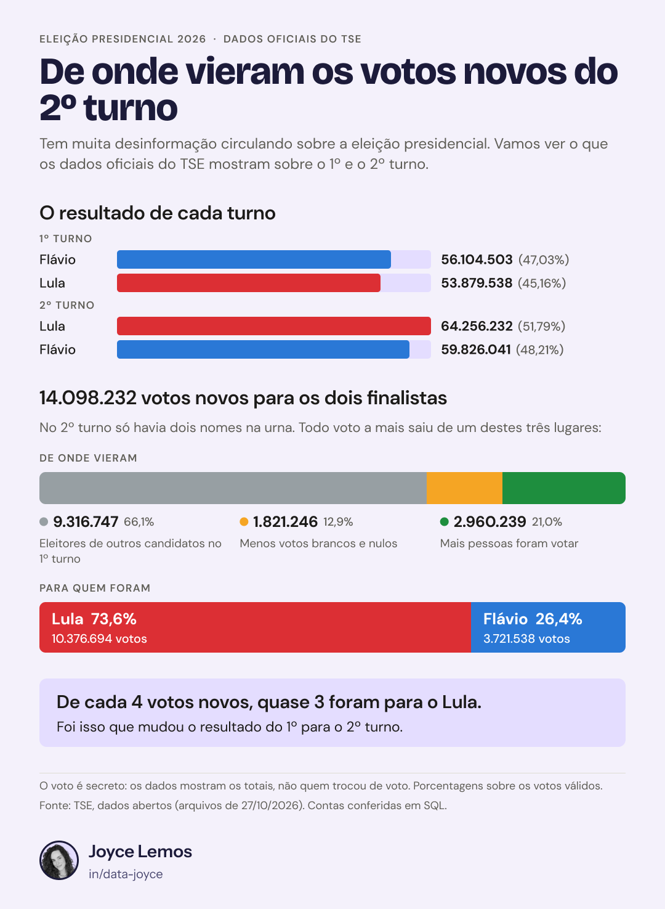

# Where Lula's Extra Votes Came From in Brazil's 2026 Presidential Runoff

An original SQL project using official open data from Brazil's Electoral Court (TSE) to compare the first round (4 October 2026) and the second round (25 October 2026) of the presidential election, and to show exactly where the new second-round votes came from.

**Tools:** SQLite, Figma

## Goal

A lot of misinformation was going around after the election. I wanted to see what the official data shows and answer these questions:

1. How many people could vote, how many voted, and how many votes each candidate got in each round?
2. How many blank and null votes were there, and how many people didn't vote?
3. Are the totals the same in both rounds?
4. Where did Lula's extra votes come from?

## Data

From the [TSE Open Data Portal](https://dadosabertos.tse.jus.br/), president only (files ending in `_BR`), both rounds:

- `detalhe_votacao_secao_2026_BR`: eligible voters, turnout, abstention, blank and null votes for each of the 499,248 sections
- `votacao_partido_munzona_2026_BR`: votes for each candidate per city and electoral zone

The raw files are too big for GitHub, so they are not in this repo. You can download them from the link above and load them with `01_load_data.sql`.

## Files

| File | What it does |
|---|---|
| `01_load_data.sql` | Loads the two TSE files into SQLite and keeps only the columns I need |
| `02_analysis.sql` | All my queries, each one with a comment explaining what it does and the result (comments in English, with a glossary for the Portuguese TSE columns) |
| `results/` | The exact result of each query, one CSV per query |
| `infographic.png` | The infographic I made in Figma for LinkedIn (in Portuguese) |

## What I did

1. **Basic numbers:** I added up eligible voters, turnout, abstention, blank and null votes, and the votes of each candidate in each round. Percentages use valid votes, the same way the TSE does it.
2. **Quality checks:** I compared the votes typed for a candidate (section file) with the valid votes (party file). They differ by 5,246 votes in the first round: those votes went to a candidate whose registration was not valid, so the TSE counts them as null votes. I also found 423 voters who are neither "voted" nor "didn't vote": they are in 41 sections abroad that had no ballot box.
3. **Both rounds side by side:** the votes file is per city and zone, not per section, so I added up the sections of each zone with a CTE and joined them with the votes. All 6,292 zones found their votes.
4. **Where the new votes came from:** in the second round there were only two names on the ballot, so every extra vote had to come from one of three places: voters of other candidates, fewer blank and null votes, or more people voting. I checked that these three add up exactly to what the two finalists gained.
5. **Where in Brazil:** I broke the gain down by region, by state, by the strongest "third" candidate in each zone, and by how much turnout changed.

## Key findings

- **Same voters, different turnout:** 158,745,502 people could vote in both rounds. Turnout went from 78.92% to 80.78%.
- **Round 1:** Flávio Bolsonaro 56,104,503 votes (47.03%) vs Lula 53,879,538 (45.16%).
- **Round 2:** Lula 64,256,232 votes (51.79%) vs Flávio Bolsonaro 59,826,041 (48.21%).
- **Lula's gain:** Lula got 10,376,694 more votes in the second round.
- **Where they came from:** the two finalists got 14,098,232 new votes together: 9,316,747 from voters of other candidates (66.1%), 1,821,246 from fewer blank and null votes (12.9%) and 2,960,239 from more people voting (21.0%).
- **Where they went:** 10,376,694 to Lula (73.6%) and 3,721,538 to Flávio Bolsonaro (26.4%). Almost 3 out of every 4 new votes went to Lula.
- **Where in Brazil:** Lula gained votes in every region and every state. Almost half of his gain, 4,800,333 votes (46%), came from the Southeast, and São Paulo alone gave him 2,613,861.
- **A clue:** in the 4,740 zones where Augusto Cury was the third most voted candidate, Lula got 8,353,281 of the 10,935,340 new votes (76.4%). Where Renan Santos or Ronaldo Caiado were the strongest third candidate, he got about 64%.

## Skills

Joins, CTEs, subqueries, `CASE WHEN`, window functions (`SUM() OVER (PARTITION BY)`), aggregation, data quality checks, data visualization in Figma.

## Limitations

- **The vote is secret.** The data shows totals going up and down, not who changed their vote.
- **These are net numbers.** Some people who voted for Lula in round 1 may have stayed home in round 2, and some who skipped round 1 may have voted for him. Those moves cancel out inside the totals.
- **The zone pattern is a clue, not proof.** It describes places, not people.
